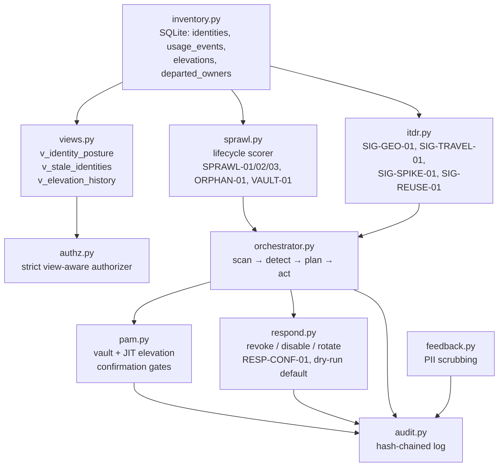

# Architecture

Data flow: the posture agent reads only through the gateway views, scores
and detects, then acts through PAM/response — every mutation audited, every
destructive step confirmation-gated.
